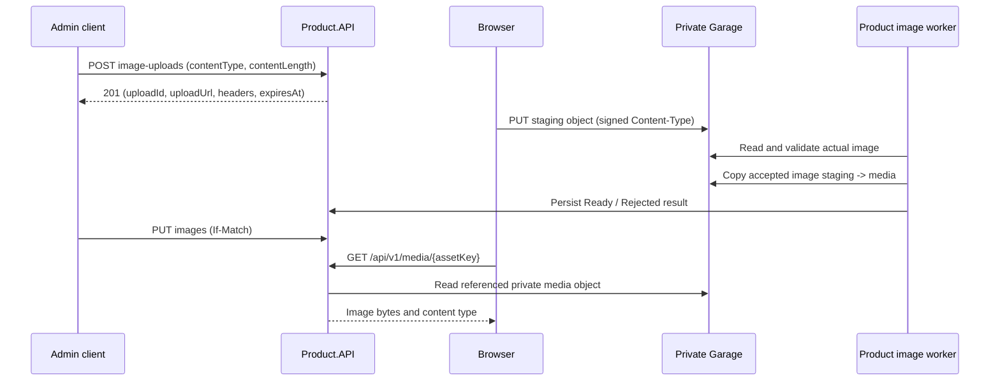
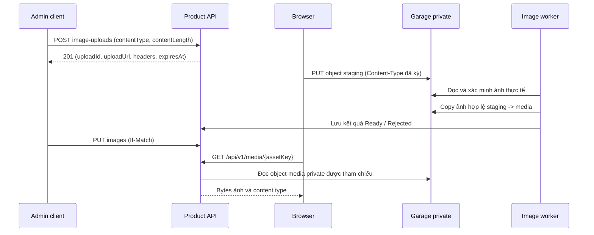

# Product Image Architecture

## English

### Ownership and flow

Product.API owns upload sessions, image validation and processing, gallery membership, authorization, metadata, and cleanup. The shared `IObjectStorage` abstraction performs generic object operations; Garage remains private. The browser uploads bytes directly to `product-staging` with a short-lived presigned PUT. A hosted processor validates the actual object, copies accepted content to `product-media`, and updates the upload state. Admin then attaches Ready uploads to the ordered gallery. Public delivery streams only an image referenced by a Published product.

### API contract

Routes are defined by `ProductImageAdminController` and `ProductImageDeliveryController`:

| Method and route | Behavior | Response |
| --- | --- | --- |
| `POST /api/v1/admin/products/{id:long}/image-uploads` | Create a session from `contentType` and `contentLength`; requires create permission | `201` with `uploadId`, `uploadUrl`, required `headers`, `expiresAt`; Location points to the status route |
| `GET /api/v1/admin/products/{id:long}/image-uploads/{uploadId:long}` | Read session state; requires view permission | `200` with status and expiry data, `404` if absent |
| `PUT /api/v1/admin/products/{id:long}/images` | Replace ordered gallery from `images: [{uploadId, altText}]`; requires update permission and `If-Match` | `200` and new `ETag` |
| `GET /api/v1/media/{assetKey}` | Deliver a referenced image for a Published product | `200` image bytes; `404` when not publicly deliverable |

The upload response's `Content-Type` header must be sent unchanged with the raw bytes in the presigned PUT. Do not send JSON, multipart data, or an Authorization header to Garage. Treat the presigned URL as a temporary bearer credential and do not log it.

### Processing, states, and cleanup

Persisted upload states are `Pending`, `Ready`, `Rejected`, `Expired`, and `Cleaned`. Processing is represented by the `ProcessingStartedAt` lease on a Pending upload, not by a persisted `Processing` enum value. The processor claims pending sessions, checks the object in staging, validates size and supported image content by inspecting/decoding actual bytes, and copies accepted content to the media bucket. Failures are recorded and cleanup requests are handled by the background processor; transient storage failure behavior is covered by focused tests. Gallery replacement accepts only Ready uploads owned by the product and enforces the configured maximum. `If-Match` protects the product version; stale versions return `412`, missing precondition returns `428`.

Current `ProductMedia` defaults: `product-staging`, `product-media`, upload URL 10 minutes, maximum file size 5 MiB, maximum 10 gallery images, pending session expiration 30 minutes, cleanup retention 30 minutes, and MIME types JPEG, PNG, WebP. These values are configuration defaults, not evidence that production uses them.

### CORS, configuration, and verification

Garage bucket CORS and Product.API CORS are both currently disabled. Garage CORS controls browser access to the direct staging PUT; Product.API CORS controls cross-origin browser calls to the API. Neither is authentication, authorization, nor bucket permission. Do not use wildcard origins or enable either policy until the actual browser origins and request path are approved. The direct upload needs the exact origin, `PUT`, and `Content-Type`; API requirements depend on the actual API boundary and may include `Authorization`, `If-Match`, and readable `ETag`.

Product.API uses `ObjectStorage:S3` settings through the shared adapter. Use `ServiceUrl` for server-to-server calls and optional `PresignedServiceUrl` when the caller needs a different reachable hostname; region and path-style behavior must match Garage. Keep credentials in the existing ignored local secret file or deployment secret store. Start local Garage using the instructions in [Garage local development](../../infrastructure/garage/02-garage-local-development.md), then provision/verify only through the documented scripts.

Run Product.API tests with `dotnet test .\test\Product.API.Tests\Product.API.Tests.csproj`. Storage unit tests are in `test/BuildingBlocks/ObjectStorage.S3.Tests`; the real Garage integration test is opt-in and requires a dedicated test bucket/key. Do not use Product buckets for destructive integration tests. Browser E2E remains unverified until the MFE origin and CORS policy are approved.

Troubleshooting: connection failures usually indicate the wrong host endpoint for the caller's network; `AccessDenied` indicates key/bucket permissions; signature mismatch commonly means URL, region, method, or signed `Content-Type` changed; missing staging objects can expire or be removed before processing; copy/delete failures should be diagnosed from Product.API and Garage logs without logging presigned query strings or secrets.

## Tiếng Việt

### Ranh giới và luồng xử lý

Product.API sở hữu upload session, xác minh và xử lý ảnh, quan hệ ảnh-gallery, phân quyền, metadata và cleanup. Abstraction `IObjectStorage` dùng cho thao tác object tổng quát; Garage luôn private. Browser tải bytes trực tiếp lên `product-staging` bằng presigned PUT có thời hạn ngắn. Background processor xác minh object thực tế, copy nội dung hợp lệ sang `product-media` rồi cập nhật trạng thái upload. Admin gắn upload Ready vào gallery có thứ tự. Public delivery chỉ stream ảnh được tham chiếu bởi product Published.

### Hợp đồng API

Các route được khai báo trong `ProductImageAdminController` và `ProductImageDeliveryController`:

| Method và route | Chức năng | Response |
| --- | --- | --- |
| `POST /api/v1/admin/products/{id:long}/image-uploads` | Tạo session từ `contentType`, `contentLength`; cần quyền create | `201` gồm `uploadId`, `uploadUrl`, `headers`, `expiresAt`; Location trỏ tới route đọc trạng thái |
| `GET /api/v1/admin/products/{id:long}/image-uploads/{uploadId:long}` | Đọc trạng thái session; cần quyền view | `200` gồm trạng thái và thời hạn; `404` nếu không có |
| `PUT /api/v1/admin/products/{id:long}/images` | Thay gallery theo thứ tự từ `images: [{uploadId, altText}]`; cần quyền update và `If-Match` | `200` và `ETag` mới |
| `GET /api/v1/media/{assetKey}` | Phân phối ảnh được tham chiếu bởi product Published | `200` bytes ảnh; `404` nếu không được phân phối công khai |

Header `Content-Type` trong response upload phải được gửi nguyên giá trị cùng raw bytes khi PUT presigned. Không gửi JSON, multipart hoặc Authorization tới Garage. Presigned URL là bearer credential tạm thời; không ghi log URL.

### Xử lý, trạng thái và cleanup

Các trạng thái upload được lưu là `Pending`, `Ready`, `Rejected`, `Expired`, `Cleaned`. Quá trình xử lý được biểu diễn bằng lease `ProcessingStartedAt` trên upload Pending, không có enum `Processing` được lưu. Processor nhận session pending, kiểm tra object staging, xác minh kích thước và loại ảnh bằng cách đọc/giải mã bytes thực tế, rồi copy nội dung hợp lệ sang media bucket. Lỗi được ghi nhận và cleanup request được background processor xử lý; tình huống lỗi storage tạm thời có test riêng. Gallery chỉ nhận upload Ready thuộc product và tuân thủ giới hạn cấu hình. `If-Match` bảo vệ version product; version cũ trả `412`, thiếu precondition trả `428`.

Giá trị mặc định `ProductMedia`: `product-staging`, `product-media`, URL upload 10 phút, file tối đa 5 MiB, tối đa 10 ảnh/gallery, pending session hết hạn sau 30 phút, cleanup retention 30 phút, MIME JPEG/PNG/WebP. Đây là giá trị cấu hình mặc định, không khẳng định production đang dùng chúng.

### CORS, cấu hình và kiểm chứng

CORS trên Garage bucket và Product.API hiện đều chưa bật. Garage CORS điều khiển browser gọi PUT trực tiếp tới staging; Product.API CORS điều khiển browser gọi API khác origin. Hai cơ chế này không thay thế xác thực, phân quyền hay quyền bucket. Không dùng wildcard hoặc bật policy trước khi origin và luồng request thực tế được duyệt. Upload trực tiếp cần đúng origin, `PUT`, `Content-Type`; yêu cầu phía API phụ thuộc boundary thực tế và có thể gồm `Authorization`, `If-Match`, cùng quyền đọc `ETag`.

Product.API dùng cấu hình `ObjectStorage:S3` qua shared adapter. Dùng `ServiceUrl` cho request server-to-server và `PresignedServiceUrl` tùy chọn nếu client cần hostname khác có thể truy cập; region và path-style phải khớp Garage. Lưu credential trong secret file local bị Git bỏ qua hoặc secret store của deployment. Làm theo [hướng dẫn Garage local](../../infrastructure/garage/02-garage-local-development.md), chỉ provision/verify bằng script đã tài liệu hóa.

Chạy Product.API tests bằng `dotnet test .\test\Product.API.Tests\Product.API.Tests.csproj`. Storage unit test nằm trong `test/BuildingBlocks/ObjectStorage.S3.Tests`; Garage integration test thật là opt-in, cần test bucket/key riêng. Không dùng bucket Product cho integration test có thao tác xóa. Browser E2E chưa được xác minh do origin MFE và policy CORS chưa được duyệt.

Chẩn đoán: lỗi kết nối thường do chọn sai hostname theo mạng của caller; `AccessDenied` thường do quyền key/bucket; signature mismatch thường do URL, region, method hoặc `Content-Type` đã ký bị đổi; staging object có thể hết hạn hoặc bị xóa trước khi worker xử lý; xem log Product.API/Garage để điều tra lỗi copy/delete nhưng không ghi query presigned URL hay secret.
